# Schemi Mermaid avanzati

## Obiettivo
Produrre schemi Mermaid corretti per i tipi meno comuni, con un esempio completo e valido per ciascuno (gli altri tipi: vedi `schemi-mermaid`).

## Quando applicarla
- Eventi nel tempo (`timeline`), piano con date (`gantt`), versioni (`gitGraph`), bacheca (`kanban`).
- Proporzioni (`pie`), serie numeriche (`xychart`), flussi con quantità (`sankey`), insiemi (`venn-beta`).
- Griglie (`block-beta`), campi di bit (`packet`), servizi cloud (`architecture-beta`).
- Responsabilità per attore (`swimlane-beta`) e sequenze scritte come codice (`zenuml`).

## Regole
1. Tipo dai dati: tempo → timeline/gantt; quantità → pie/xychart/sankey; insiemi → venn.
2. Etichette chiare, circa 12 elementi al massimo; testo con simboli tra doppi apici.
3. Tipi `-beta` hanno sintassi mutabile; `zenuml` è un plugin: in Obsidian "da verificare".
4. `pie`: valori positivi (max 2 decimali). `gantt`: ogni `after id` rimanda a un id esistente.
5. `packet`: campi in ordine crescente di bit, senza buchi, mai `7-0`.
6. `venn`/`architecture`/`block`: gli id usati vanno prima dichiarati.
7. `kanban`: compiti indentati sotto la colonna; id unici. Priorità: Very High, High, Medium, Low, Very Low.
8. Commenti `%% testo` su riga propria; configurazione solo nel front matter `config:` (altre chiavi: "da verificare").
9. Aspetto precedente (venn, swimlane): front matter `config:` con `theme: default` e `look: classic`.

## Formato di output
### Per l'app e per Obsidian
Blocco di codice con linguaggio `mermaid`, come negli esempi sotto: il sito lo disegna e Obsidian lo disegna. Il campo `diagrams` resta `[]`.

**Torta e ciambella** (`pie`, `showData` mostra i valori; opzioni `textPosition`, `donutHole`, `legendPosition`, `highlightSlice`)
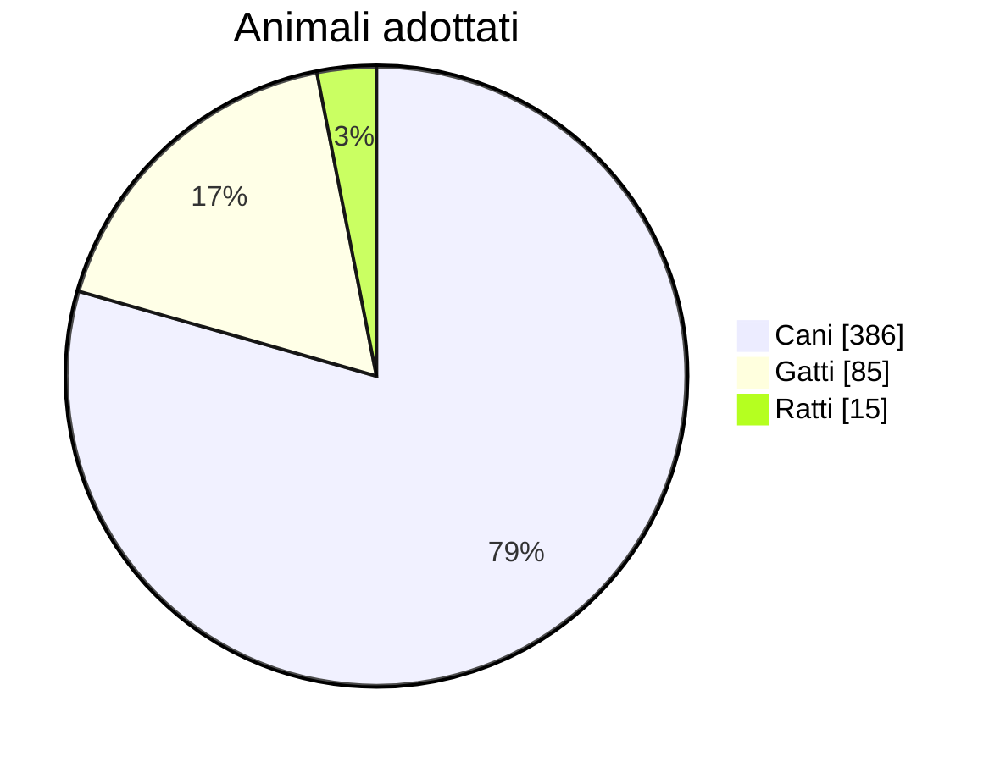
**Cronologia** (periodo : evento : altro evento; `section` raggruppa; `<br>` va a capo)
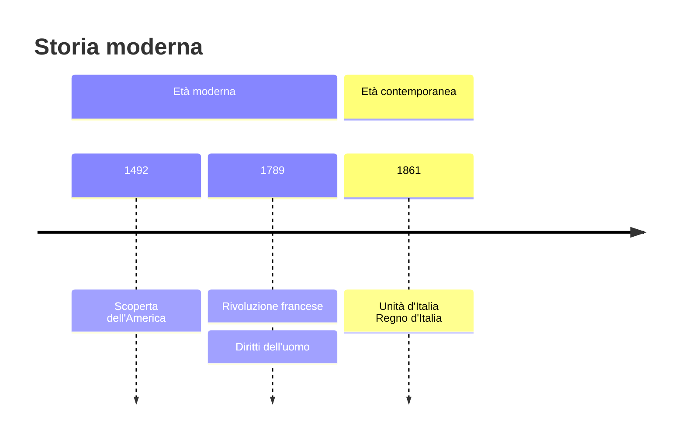
**Gantt** (stati `done`, `active`, `crit`, `milestone`, `vert`; `after id`; `excludes weekends`; `axisFormat`, `tickInterval`, `todayMarker`)
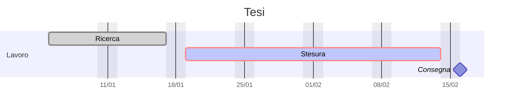
**Versioni** (`commit id/tag/type`, `branch`, `checkout`/`switch`, `merge`, `cherry-pick`; tipi NORMAL, REVERSE, HIGHLIGHT)
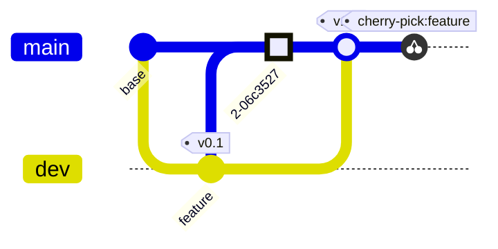
**Grafico a barre e linee** (`xychart horizontal` per orientamento; serie con nome entrano in legenda)
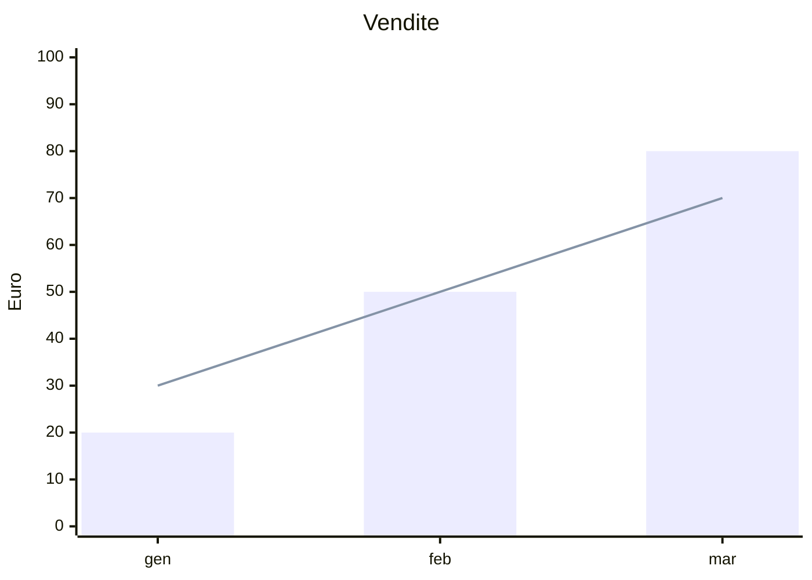
**Flussi con quantità** (`sankey`, righe `origine,destinazione,valore`, valori positivi)
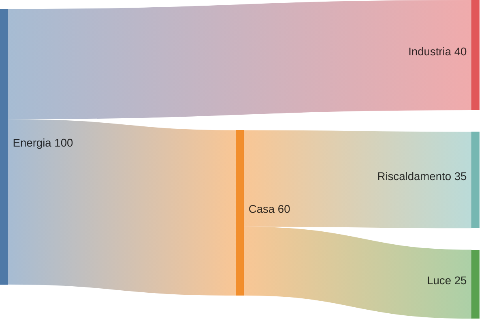
**Bacheca** (metadati `ticket`, `assigned`, `priority`; link ticket con `ticketBaseUrl` e `#TICKET#`)
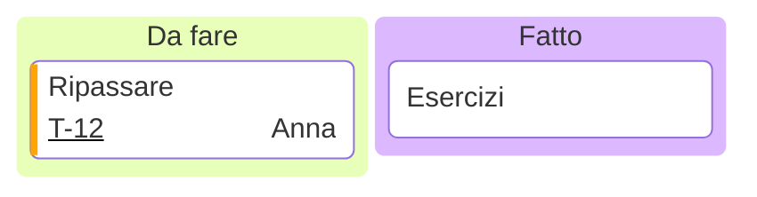
**Insiemi** (`set`, `union` anche di 3+ insiemi, `text` annidato, `:N` dimensione, `style` con fill, color, stroke, stroke-width, fill-opacity)
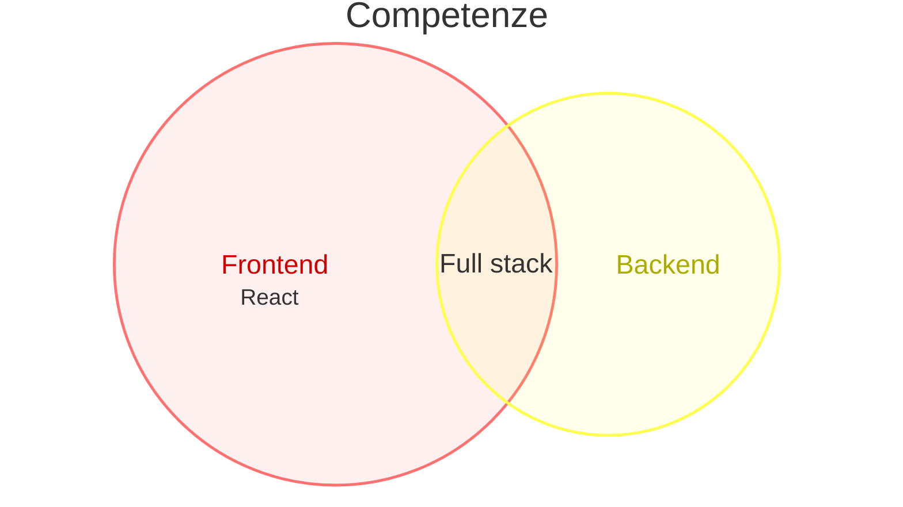
**Pacchetto** (`inizio-fine: "campo"`, `+N` bit consecutivi; opzioni `showBits`, `bitsPerRow`, `bitOrder: descending`)
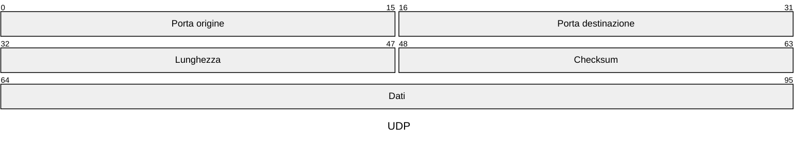
**Cloud** (`group`, `service`, `junction`, lati T/B/L/R, frecce `<`/`>`, `{group}` per archi tra gruppi, `align row|column`)

**Blocchi** (`columns N`, larghezza `:N`, `space`, `block:id … end`, forme `(( ))`, `[( )]`, `{ }`, frecce `<["x"]>(right)`, `style`)
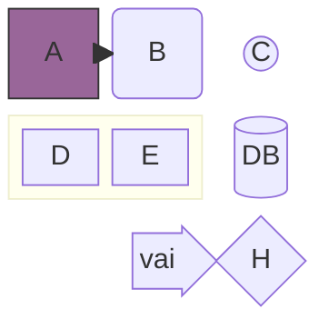
**Corsie** (`swimlane-beta` + direzione; ogni `subgraph` è una corsia, con id e titolo `subgraph id [Titolo]`)
```mermaid
swimlane-beta LR
    subgraph cli [Cliente]
        R[Richiede]
        A[Riceve]
    end
    subgraph sup [Supporto]
        T[Risponde]
    end
    R -->|ticket| T
    T --> A
```
**Sequenza a codice** (`zenuml`: messaggi, `new`, `if/else`, `while`, `for`, `try/catch`, `return`, commenti `//`)
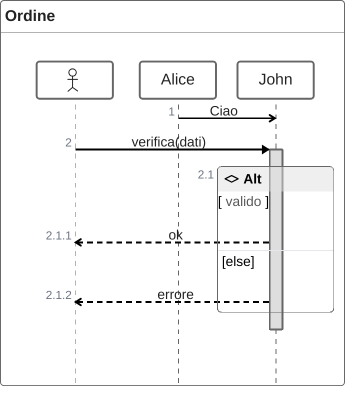

## Esempio
Input: «Nel 2020 inizia il progetto, nel 2022 esce la versione 1.»
Output Obsidian:
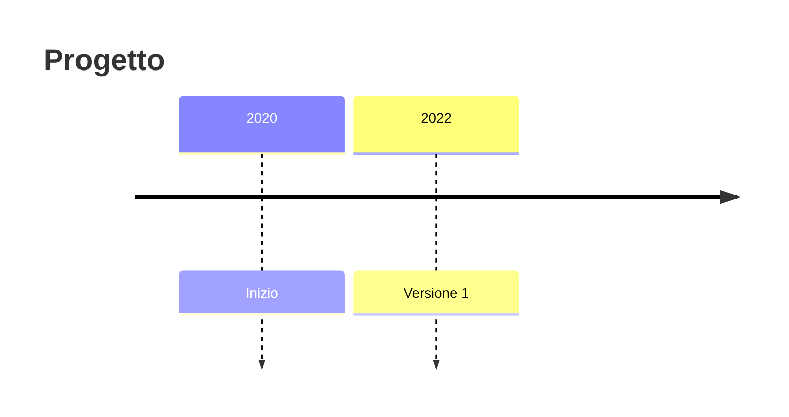

## Da non fare
- Non usare id non dichiarati, valori negativi in `pie`, campi `packet` con buchi.
- Non eliminare, riassumere o generalizzare le informazioni dell'utente.
- Non inventare sintassi assente dalle fonti: scrivi "da verificare".
