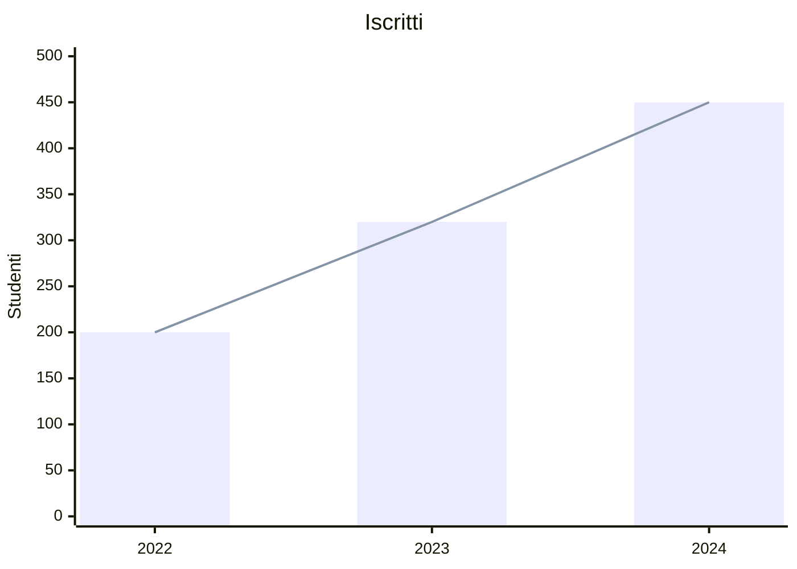
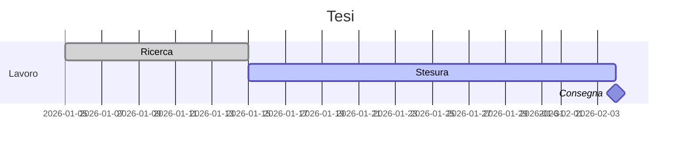
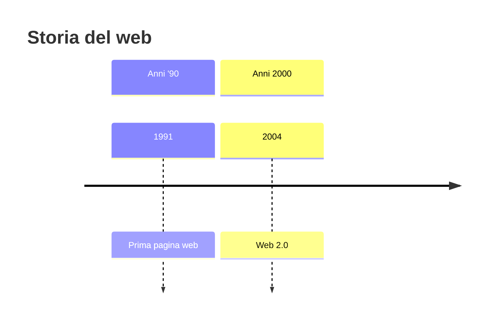
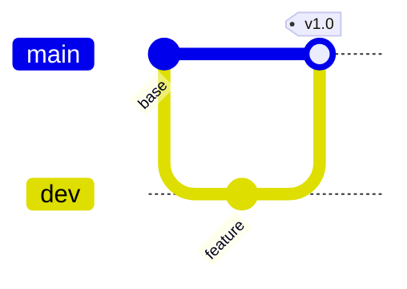
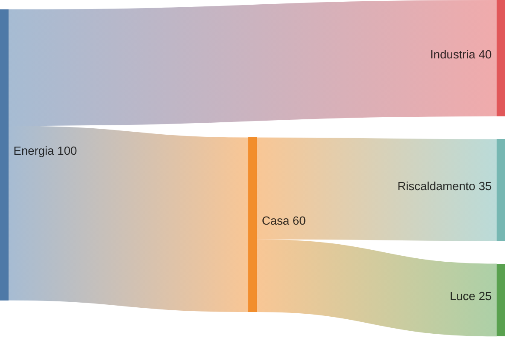
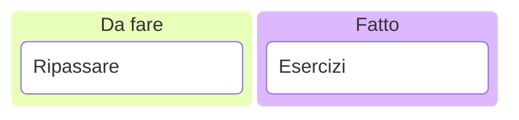
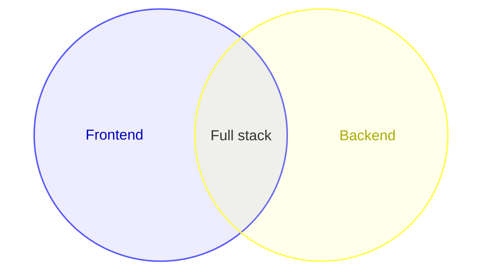
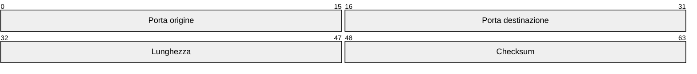
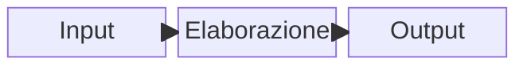
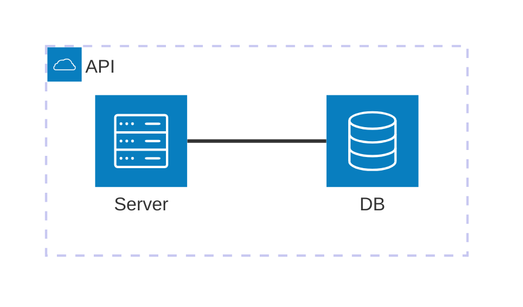

# Schemi Mermaid avanzati

Usali solo quando la struttura della lezione corrisponde esattamente al tipo. Valgono le regole di `schemi-mermaid` (pochi elementi, etichette brevi, dati solo dalla lezione). Un blocco ` ```mermaid ` per schema; il campo `diagrams` resta `[]`.

## Regole
1. Etichette con simboli o spazi tra doppi apici; circa 12 elementi al massimo.
2. `gantt`: ogni `after id` rimanda a un id esistente. `pie` e `sankey`: solo valori positivi.
3. `packet`: campi in ordine crescente di bit, senza buchi.
4. `architecture-beta`, `block-beta`, `venn-beta`: dichiara gli id prima di usarli. I tipi `-beta` hanno una sintassi che può cambiare: preferisci un tipo stabile quando basta.
5. `zenuml` non viene disegnato dal sito: per le sequenze usa `sequenceDiagram`.

## Esempi validi
**Serie numeriche** (`xychart`, barre e linee)

**Piano con date** (`gantt`; stati `done`, `active`, `crit`, `milestone`)

**Cronologia con periodi** (`timeline` con `section`)

**Versioni** (`gitGraph`)

**Flussi con quantità** (`sankey`, righe `origine,destinazione,valore`)

**Bacheca** (`kanban`, compiti indentati sotto la colonna)

**Insiemi** (`venn-beta`)

**Campi di bit** (`packet`)

**Griglia di blocchi** (`block-beta`)

**Servizi cloud** (`architecture-beta`)

**Responsabilità per attore** (`swimlane-beta`, ogni `subgraph` è una corsia)
```mermaid
swimlane-beta LR
    subgraph cli [Cliente]
        R[Richiede]
        A[Riceve]
    end
    subgraph sup [Supporto]
        T[Risponde]
    end
    R --> T
    T --> A
```
