# Schemi Mermaid

## Obiettivo
Produrre schemi corretti e completi, solo quando aiutano a capire, senza sostituire il testo dell'utente.

## Quando applicarla
- Processo con passi e decisioni: `flowchart`; con responsabilità per attore: `swimlane-beta`.
- Scambio di messaggi tra attori: `sequenceDiagram` (alternativa a codice: `zenuml`).
- Gerarchia o mappa di concetti: `mindmap`. Classi e relazioni: `classDiagram`. Stati e transizioni: `stateDiagram-v2`.
- Altri casi (tabella sotto): cronologie, piani, versioni, proporzioni, serie, flussi, insiemi, griglie, bit, cloud.

## Regole
1. Ogni nodo ha un'etichetta chiara; ogni freccia ha un verso; nessun nodo isolato.
2. Massimo 8 nodi per schema: oltre, dividi in più schemi. Etichette brevi (massimo 5 parole).
2b. Forme: `[testo]` rettangolo per ogni passo; `{testo}` rombo solo per una domanda sì/no di massimo 3 parole. Non mettere frasi lunghe dentro il rombo.
3. La prima riga è il tipo di diagramma; direzioni `TD`/`TB`, `LR`, `BT`, `RL`.
4. Testo con parentesi o simboli tra doppi apici: `A["testo (con parentesi)"]`.
5. In flowchart `end` minuscolo in un nodo rompe il diagramma: scrivi `End`. In sequenceDiagram usa `(end)`.
6. Commenti: `%% testo` su riga propria. In sequenceDiagram `#` è un codice di escape (`#35;` = `#`, `#59;` = `;`): non scriverlo da solo.
7. Tipi `-beta` (`venn`, `swimlane`, `architecture`, `block`, `sankey`) hanno sintassi mutabile; `zenuml` è un plugin: in Obsidian "da verificare".
8. Colori: usa `classDef` con questi colori pastello e assegnali ai nodi importanti:
   - `classDef errore fill:#FEE2E2,stroke:#DC2626,color:#1E293B`
   - `classDef ok fill:#DCFCE7,stroke:#16A34A,color:#1E293B`
   - `classDef info fill:#DBEAFE,stroke:#2563EB,color:#1E293B`
   - `classDef nota fill:#FEF9C3,stroke:#CA8A04,color:#1E293B`
   Esempio: `class A ok` oppure `A:::ok`. Non più di tre colori per schema.
9. Dimensione: uno schema per concetto. Se serve più dettaglio, fai uno schema per fase invece di uno schema enorme.
10. Stile solo se serve: `linkStyle`, `class A internal-link;` (nodo che apre la nota in Obsidian).

## Formato di output
### Per l'app e per Obsidian
Lo schema va nel testo come blocco di codice con linguaggio `mermaid`: il sito lo disegna e Obsidian lo disegna. Il campo `diagrams` resta `[]`. Esempio di flowchart (sintassi identica per entrambi):
Esempi completi e validi per ogni tipo:
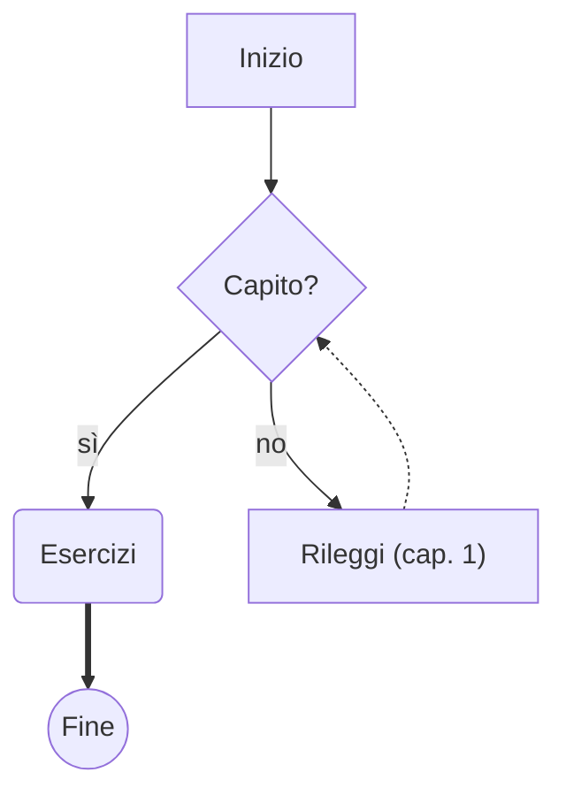
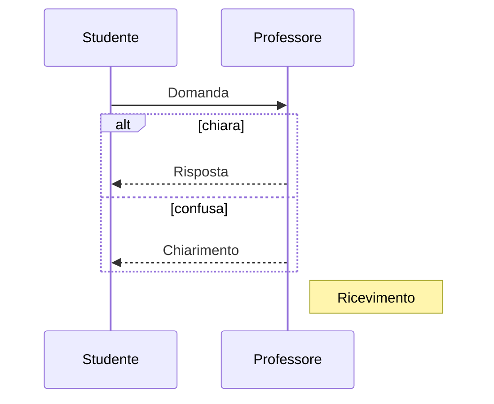
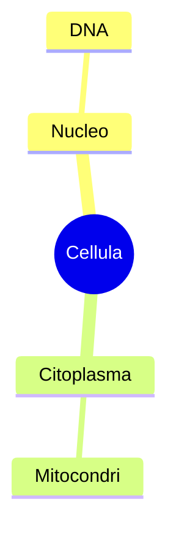
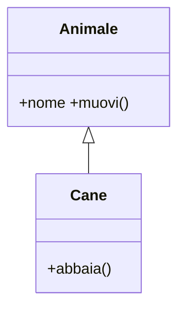
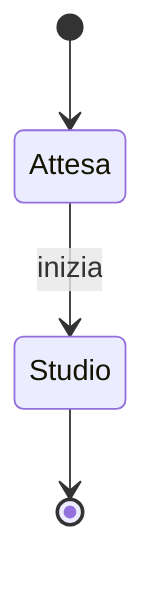
Funzioni avanzate dei cinque tipi (esempi validi):
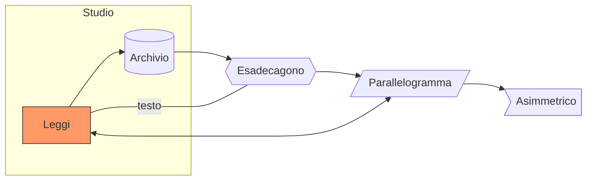
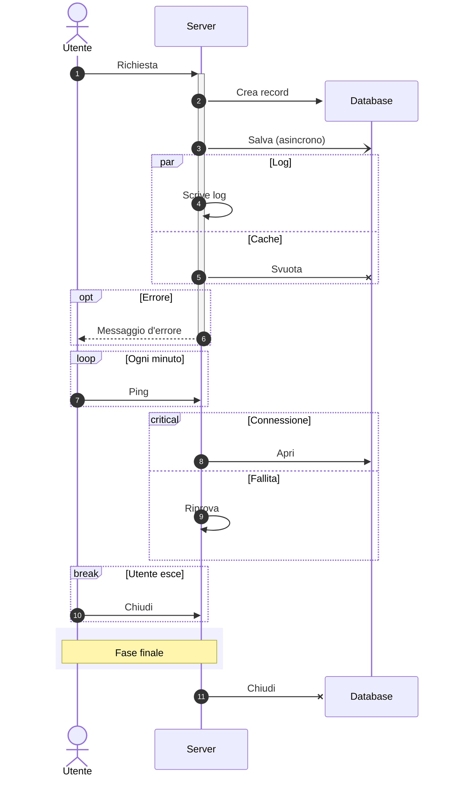
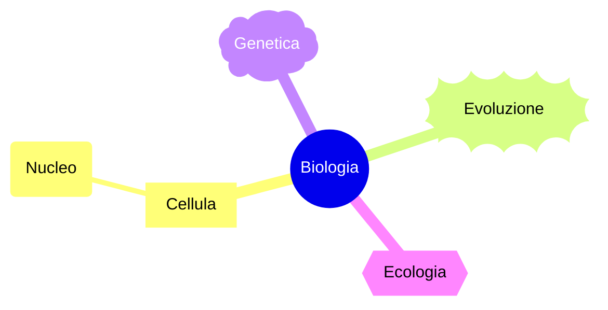
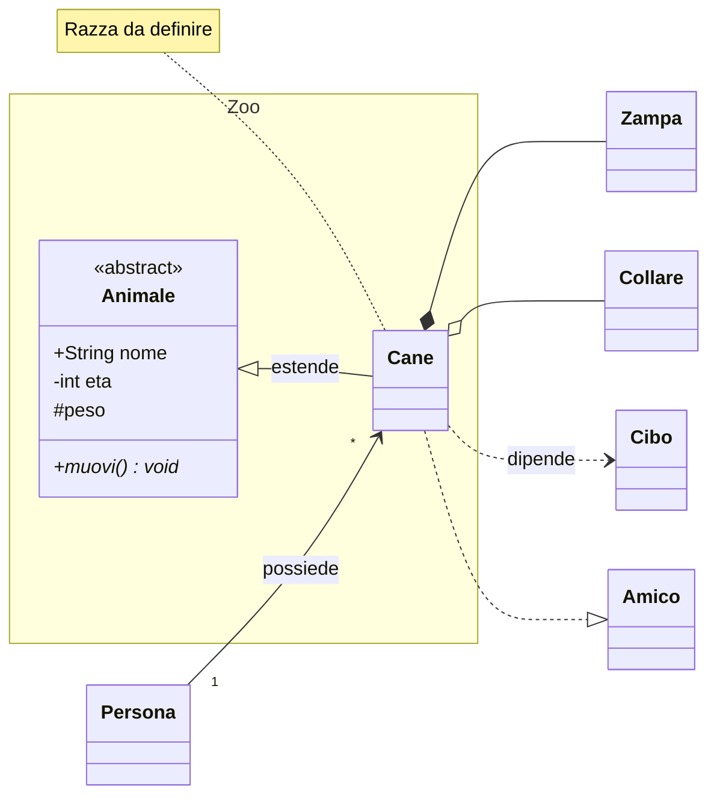
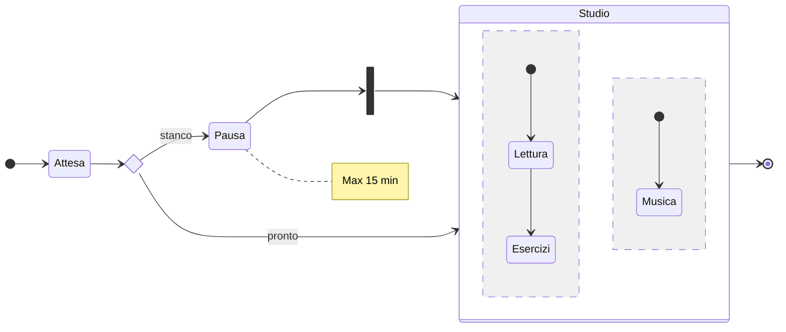
## Esempio
Input: «Prima si studia; se non si è pronti si ripassa, poi si fa l'esame.»
Output Obsidian:
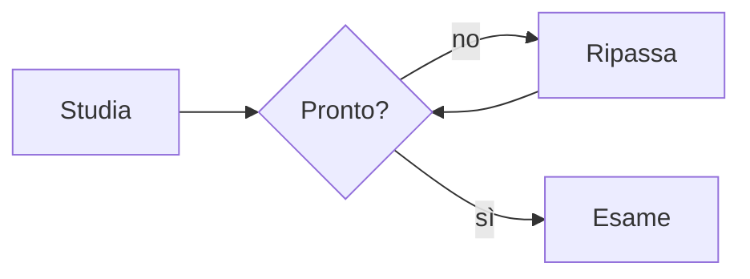

## Da non fare
- Non lasciare nodi isolati, frecce senza verso o etichette vuote.
- Non usare `end` minuscolo nei nodi né simboli senza doppi apici.
- Per gli altri tipi (timeline, gantt, pie…) usa `schemi-mermaid-avanzati`.
- Non eliminare, riassumere o generalizzare le informazioni dell'utente: lo schema le affianca.
- Non inventare sintassi assente dalle fonti: scrivi "da verificare".
