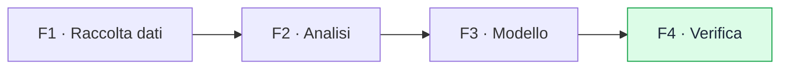
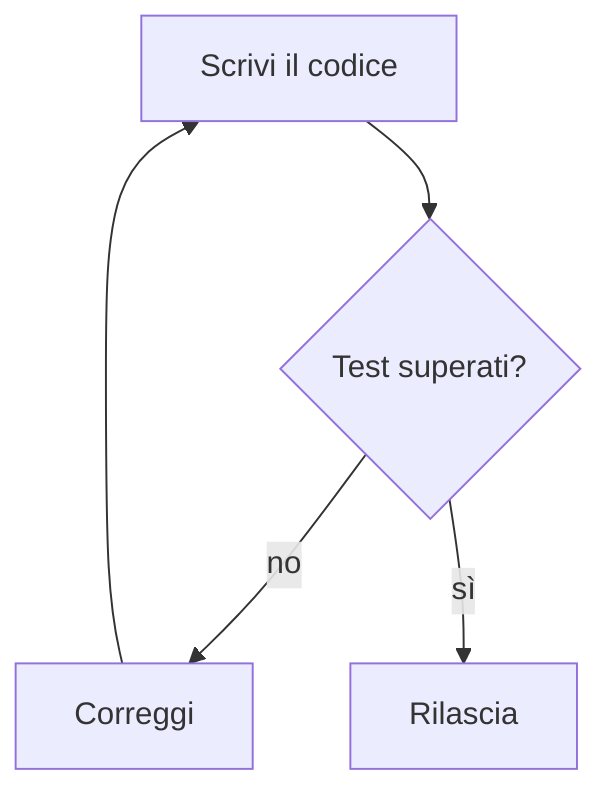
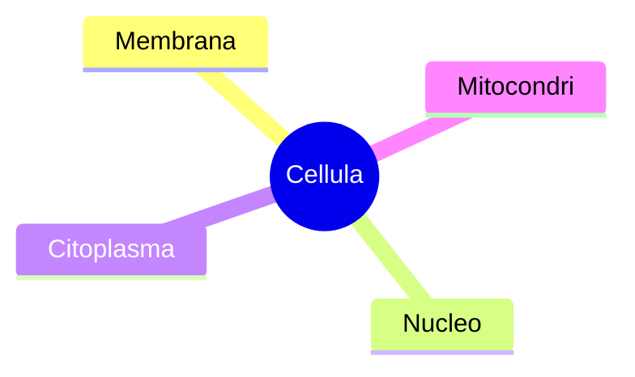
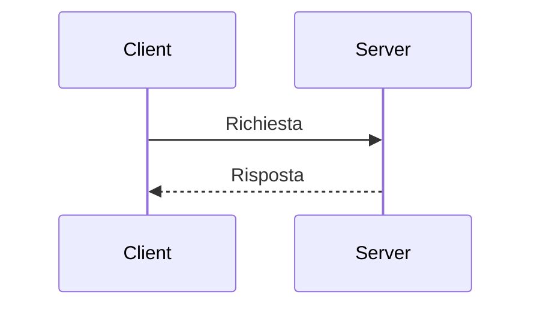
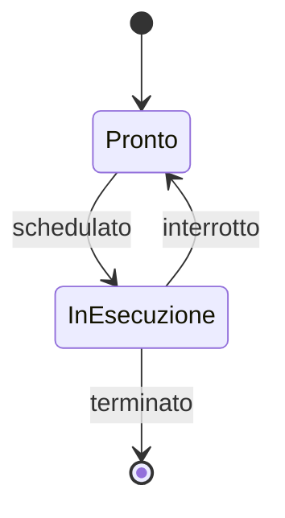
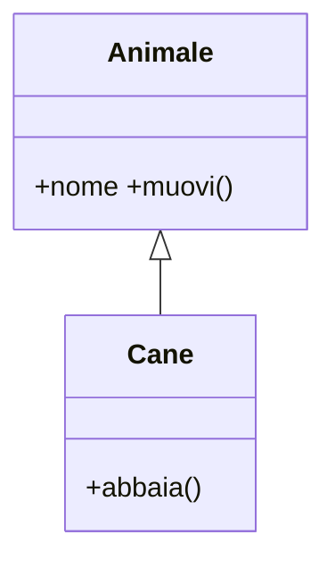
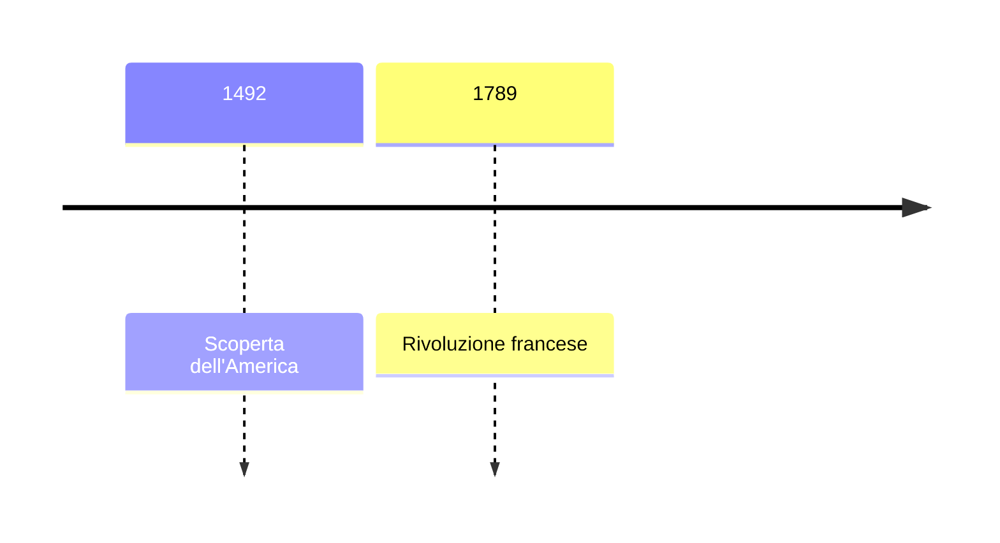
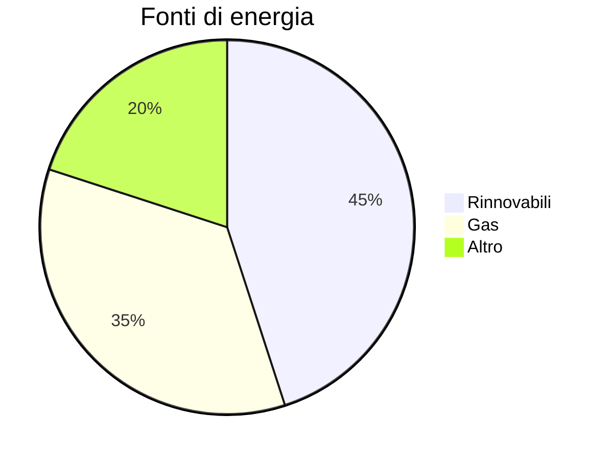

# Schemi Mermaid

## Quando
Inserisci uno schema solo se nella lezione c'è una di queste strutture:

| Struttura nella lezione | Tipo di schema |
| --- | --- |
| Progressione a livelli o fasi | `flowchart LR` |
| Processo con una decisione | `flowchart TD` |
| Concetto composto da 3–6 parti | `mindmap` |
| Scambio di messaggi tra attori | `sequenceDiagram` |
| Stati e passaggi tra stati | `stateDiagram-v2` |
| Classi ed ereditarietà | `classDiagram` |
| Eventi con date | `timeline` |
| Proporzioni, percentuali | `pie` |
| Serie di numeri nel tempo | `xychart` |
| Piano di lavoro con date | `gantt` |
| Altri casi (versioni, flussi con quantità, bacheche, griglie, bit, cloud, insiemi, corsie) | vedi `schemi-mermaid-avanzati` |

- Da 1 a 3 schemi per lezione, uno per concetto. In una lezione lunga ce n'è almeno uno: se manca un processo, fai una `mindmap` della struttura della lezione.
- Per una catena di 2–4 passi senza decisioni non serve uno schema: basta una riga con le frecce nel testo.
- Lo schema va subito dopo il paragrafo che lo spiega, introdotto da una frase. Il testo resta completo: lo schema affianca le informazioni, non le sostituisce.
- I dati di `pie` e `xychart` devono essere numeri detti a lezione: non inventarli.

## Regole (l'app le controlla)
1. Massimo 6 nodi, limite assoluto 8. Se ne servono di più, fai due schemi.
2. Etichette di massimo 5 parole. Se contengono simboli o parentesi, mettile tra doppi apici: `A["Testo (x)"]`.
3. Il rombo `{"…?"}` serve solo per una domanda di massimo 3 parole, con due uscite `|sì|` e `|no|`. Ogni azione è un rettangolo `[...]`. Lo schema non inizia mai con un rombo.
4. Un'etichetta non inizia con "numero e punto" (`"1. Fase"` diventa un elenco): scrivi `"F1 · Fase"` o `"Fase 1"`.
5. Non usare `end` minuscolo come etichetta: scrivi `Fine`.
6. Commenti: `%% testo` su una riga a sé. La prima riga è sempre il tipo di schema.
7. Colori facoltativi, massimo 2 per schema, solo questi (stessi significati delle evidenze):
   - `classDef ok fill:#DCFCE7,stroke:#16A34A,color:#1E293B` (risultato, concetto chiave)
   - `classDef errore fill:#FEE2E2,stroke:#DC2626,color:#1E293B` (errore, rischio)
   - `classDef info fill:#DBEAFE,stroke:#2563EB,color:#1E293B` (esempio, dettaglio)
   - `classDef nota fill:#FEF9C3,stroke:#CA8A04,color:#1E293B` (da ricordare)
   Assegnali con `class A ok` o `A:::ok`.

## Esempi validi
Progressione:

Processo con decisione:

Parti di un concetto:

Attori:

Stati:

Classi:

Date:

Proporzioni:

